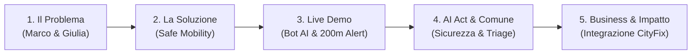

# 🎤 PITCH DECK & GUIDA ALLA PRESENTAZIONE
## CityFix · Safe Mobility Module
**Hackathon Didap 2026 · Chiostro Polo dell'Innovazione**  
*Tempo stimato pitch: 4-5 minuti + Q&A Giuria*

---

## 📊 Struttura della Presentazione (Slide by Slide)

---

### Slide 1: Introduzione & Hook (30 secondi)
- **Titolo**: *CityFix Safe Mobility: La rete civica di sicurezza predittiva in tempo reale.*
- **Lo Storytelling**:  
  > *"Immaginate Marco. Alle 13:15 è fermo a un incrocio del centro: c'è un brutto incidente, due auto distrutte e vetri sull'asfalto. A soli 200 metri c'è Giulia, 16 anni, che torna da scuola in bicicletta. Oggi Giulia non ha modo di saperlo finché non ci si ritrova in mezzo. Quanti minuti passano prima che un pericolo venga rimosso o prima che qualcun altro si faccia male? Con il nuovo modulo Safe Mobility di CityFix, Marco impiega 3 secondi per avvisare chi si trova nelle vicinanze, e Giulia cambia strada prima del pericolo."*

---

### Slide 2: L'Architettura a 3 Livelli (45 secondi)
*(Ricollegamento alla Slide 05 del PDF Didap: Sicurezza, Rigenerazione Urbana, Welfare)*
1. **Livello Sicurezza (Immediato)**:
   - Segnalazione rapida e geofencing iper-locale a 200 metri.
   - Non sostituisce il 112, ma evita incidenti a catena e disagi per pedoni, ciclisti e automobilisti.
2. **Livello Rigenerazione Urbana (Collaborativo)**:
   - I cittadini convalidano: un'ora dopo, chi passa preme *"Non c'è più"* e il pericolo sparisce dalla mappa senza lasciare rumore.
3. **Livello Welfare & Pubblica Amministrazione**:
   - La Sala Operativa del Comune dispone di una dashboard per smistare Polizia Locale, Protezione Civile e squadre di manutenzione.

---

### Slide 3: Il Cuore Tecnologico: Il Bot AI Multimodale (60 secondi)
- **Il Rischio di ogni app partecipativa**: *I troll, le fake news e lo spam.*
- **Come lo risolviamo (La Logica del nostro Bot)**:
  - **Vision Multimodale**: Valuta la foto scattata dal vivo. Riconosce watermark, foto di schermi, meme e foto false non pertinenti.
  - **Codifica Cromatica di Gravità**:
    - 🟡 **Giallo**: Buca, traffico, ramo caduto (disagio).
    - 🟠 **Arancione**: Strada allagata, lite accesa, incidente lieve (attenzione).
    - 🔴 **Rosso**: Emergenza critica per l'incolumità (chiama subito il 112!).
  - **Regola dei 3 Strike con Ban 24h**:
    - Chi carica una foto non valida riceve uno strike (1/3, 2/3).
    - Al **3° strike consecutivo**, il server applica un **ban tassativo di 24 ore**, disabilitando l'invio per l'utente e proteggendo la rete.

---

### Slide 4: LIVE DEMO (90 secondi) - *Momento Wow!*
*(Aprire la schermata di localhost:8080)*
1. **Passo 1 (Login & Sicurezza)**:
   - Cliccare su *"Marco (Cittadino)"* per accedere istantaneamente con credenziali sicure.
2. **Passo 2 (Segnalazione Flash)**:
   - Cliccare su **«SEGNALA PERICOLO IN 3 SECONDI»**.
   - Selezionare preset *«Foto Vera Incidente (Rosso)»*. Mostrare la classificazione in tempo reale del Bot AI e la pubblicazione sulla mappa.
3. **Passo 3 (Allerta Giulia a 200m)**:
   - Cliccare su **«Simula Caso Giulia a 200m dall'incidente»**.
   - Mostrare il raggio di prossimità sulla mappa, il segnale acustico e il popup: *«Attenzione Giulia: Incidente a 180 metri dal tuo percorso. Cambia strada!»*.
4. **Passo 4 (Test Strike & Ban per la Giuria)**:
   - Nella scheda Bot AI, cliccare su *«Test Foto Falsa / Meme»*: mostrare come l'AI respinge la foto e assegna lo strike.
5. **Passo 5 (Risoluzione Partecipata)**:
   - Cliccare su *«Non c'è più»* sulla segnalazione: al secondo voto il pericolo sparisce istantaneamente dalla mappa.

---

### Slide 5: Conformità AI Act & Cybersecurity (30 secondi)
*(Riferimento alla sessione delle 12:00 del Programma Hackathon)*
- **AI Act Annex IV**: Trasparenza algoritmica. Ogni decisione del bot è motivata (*«Perché è giallo? Perché è rosso?»*) e consultabile nell'Audit Log comunale.
- **Nessuna profilazione biometrica illecita**: le foto non eseguono riconoscimento facciale indiscriminato né tracciamento continuo invasivo dei cittadini.
- **Data Privacy**: Geofencing calcolato sul dispositivo e sulle coordinate aggregate, crittografia sicura delle password (PBKDF2-SHA256).

---

### Slide 6: Conclusioni & Roadmap di Prodotto (30 secondi)
- **Perché CityFix Safe Mobility vince**:
  - Risponde esattamente a tutti i 5 requisiti del brief Didap.
  - Zero attrito: si avvia ovunque senza installazioni pesanti.
  - Sinergia perfetta con l'ecosistema CityFix già attivo nei comuni della Puglia.
- **Call to Action**: *«Rendiamo la mobilità più sicura, un quartiere alla volta.»*

---

## ❓ Domande & Risposte Probabili dalla Giuria

**D: Come gestite il raggio tra città metropolitana e piccoli paesi?**  
*R: In città ad alta densità (es. Bari centro) il raggio efficace per pedoni e bici è 200m, per evitare overload informativo; nei piccoli comuni o extraurbano il raggio si adatta automaticamente a 1.5 - 3 km perché le distanze e le velocità sono maggiori.*

**D: E se una persona invia una segnalazione di codice Rosso per scherzo?**  
*R: La foto è obbligatoria. L'AI analizza i pixel effettivi e la coerenza con la descrizione. Un meme o una foto finta viene respinta all'istante e fa scattare lo strike verso il ban di 24h.*

**D: Sostituite il Numero Unico 112?**  
*R: Assolutamente no. L'app evidenzia in modo prominente il pulsante "112 EMERGENZE" su ogni codice Rosso. Safe Mobility serve per allertare i vicini di casa e i passanti che altrimenti non saprebbero del pericolo prima di caderci dentro.*
